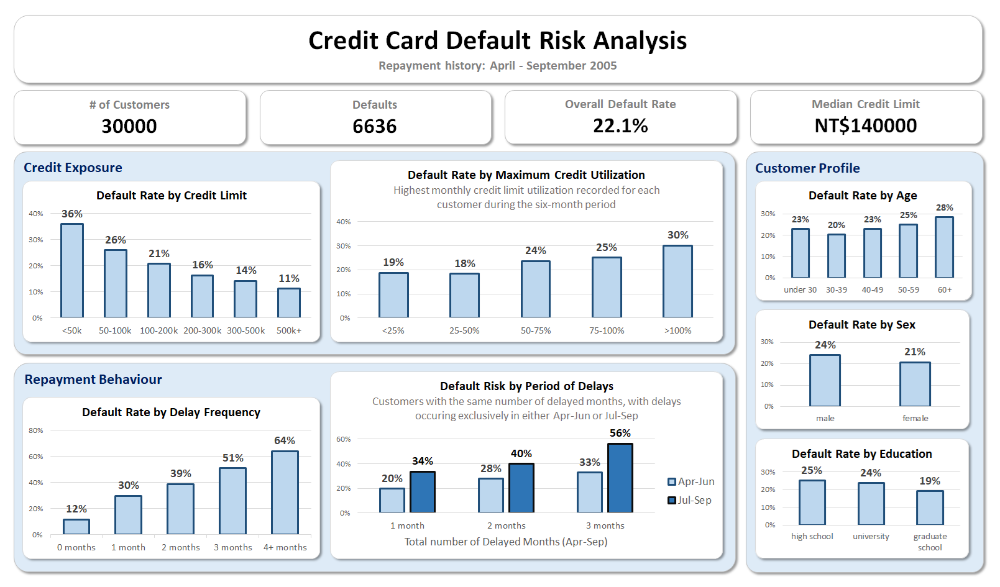
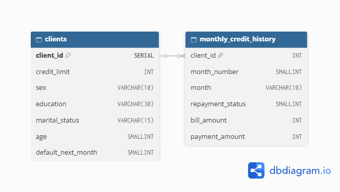

# Credit Card Default Risk Analysis

**SQL | PostgreSQL | Excel | Power Query**

This project analyzes credit card customer data to identify factors associated with payment default risk. The goal is to understand how credit exposure, repayment behaviour, and customer characteristics relate to the likelihood of default in the following month.

The dataset contains information on 30,000 credit card clients in Taiwan, covering a six-month period from April to September 2005.

The analysis focuses on three key areas:
1. Credit Exposure - credit limits and maximum credit utilization.
2. Repayment Behaviour - frequency and timing of payment delays.
3. Customer Profile - demographic characteristics and their relationship with default risk.

## Dashboard

The primary metric used throughout the analysis was the default rate, defined as the percentage of customers who defaulted in the following month.

The Excel dashboard presents the main results across three analytical areas: Credit Exposure, Repayment Behaviour, and Customer Profile.

The dashboard is connected to PostgreSQL views through Power Query, allowing the results to be refreshed when the underlying data changes.

## Analysis Summary

### Key Findings
- Overall default rate - Approximately 22% of customers defaulted in the following month.
- Credit limits - Customers with lower credit limits exhibited substantially higher default rates.
- Credit utilization - Higher maximum credit utilization was associated with increased default risk among customers whose maximum utilization exceeded 50%.
- Repayment history - Customers with more frequent payment delays generally had higher default rates.
- Delay recency - Recent payment delays were associated with higher default rates than earlier delays, even among customers with the same total number of delayed months.
- Customer profile - Demographic differences were observed, but repayment-related patterns were generally more pronounced.

### Credit Limit and Default Risk
Default rates decrease consistently as credit limits increase.
Customers with credit limits below NT$50,000 (New Taiwan dollars) had a default rate of approximately 36%, compared with approximately 11% among customers with limits of NT$500,000 or more.
This indicates a strong association between credit limits and default risk. However, the relationship should not be interpreted as causal. Higher credit limits may have been granted to customers who were already considered less risky based on information unavailable in the dataset, such as previous credit history.

### Maximum Credit Utilization and Default Risk
Maximum credit utilization represents the highest percentage of a customer's credit limit used in a single month during the six-month observation period.
Default rates were relatively similar among customers with maximum utilization below 25% and those in the 25–50% range.
Default rates began to increase in the 50–75% maximum credit utilization group and continued to rise across each subsequent utilization group.
This suggests that high credit utilization may be a useful indicator when monitoring credit risk.

### Repayment History and Default Risk
Delinquency frequency measures the number of months in which a customer had a recorded payment delay during the six-month observation period.
Customers with more frequent payment delays generally exhibited higher default rates than those with fewer or no recorded delays.
The results indicate that repayment history is an important behavioural factor associated with default risk.

### Timing of Payment Delays and Default Risk
To examine whether the timing of repayment delays matters, the six-month observation period was divided into two three-month periods:
- Earlier period: April–June 2005
- Recent period: July–September 2005

The analysis compared customers with the same total number of delayed months, with delays occurring exclusively in either the earlier or the recent period.

The table below presents default rates for customers with exactly one, two, or three delayed months.

| Period of Delay |	1 month | 2 months | 3 months |
|:---|:---:|:---:|:---:|
| April–June	| 20% | 28% | 33% |
| July–September |	34% | 40% | 56% |

In all three comparisons, customers with recent payment delays had higher default rates, with differences ranging from approximately 12 to 23 percentage points.
This suggests that recent repayment difficulties may provide additional information about default risk beyond the total frequency of delays.

### Customer Profile and Default Risk
- Age - Default rates ranged from 20% among customers aged 30–39 to 28% among those aged 60+. However, the 60+ group had a relatively small sample size (339 customers).
- Sex - Male customers had a higher default rate (24%) than female customers (21%).
- Education - Graduate school customers had the lowest default rate (19%), compared with university (24%) and high school (25%) graduates.

Overall, demographic differences were generally less pronounced than those associated with repayment behaviour.

## Business Recommendations
1. Prioritize repayment history in credit risk assessment.

Payment delay frequency showed a clear association with default rates. Customers with repeated payment delays should be considered higher-risk when assessing the likelihood of default in the following month.

2. Consider the timing of payment delays when assessing default risk.

Customers with recent delays exhibited higher default rates than customers with the same number of delayed months occurring earlier. 
Risk assessment should distinguish between recent and earlier payment delays rather than relying solely on the total number of delayed months.

3. Consider credit exposure when assessing default risk

Customers with higher credit limits generally exhibited lower default rates. Additionally, default rates increased more noticeably when maximum credit utilization exceeded 50%, with further increases across higher utilization groups.

4. Prioritize credit exposure and repayment behaviour over demographic characteristics

Demographic characteristics showed smaller differences in default rates than credit exposure and repayment-related indicators. However, these differences were still noticeable and may provide useful context when analyzing customer risk.

5. Combine multiple indicators.

Credit limit, maximum credit utilization, delinquency frequency, delay recency and demographic characteristics were all associated with differences in default rates.
Combining these indicators may provide a more comprehensive understanding of factors associated with default risk than relying on any single measure.

## Dataset Structure
Source: https://archive.ics.uci.edu/dataset/350/default+of+credit+card+clients

The dataset contains 30,000 customer records, including demographic information, credit limits, six months of financial history, and the following month's default outcome.

After importing the data into PostgreSQL, it was organized into three tables:
- credit_card_clients_raw - Preserves the original dataset without modifications.
- clients - Stores customer-level information, including demographics, credit limits, and default outcomes.
- monthly_credit_history - Stores monthly repayment statuses, bill amounts, and payment amounts.

The original dataset contained one row per customer. Monthly financial data was transformed from wide to long format, creating six records per customer. The diagram below illustrates the one-to-many relationship between the two analytical tables. The raw data table is not included in the diagram.

## Project Workflow
The project involved the following stages:
1. Importing the dataset into PostgreSQL, cleaning the data, and transforming it into a relational database structure.
2. Conducting exploratory and descriptive analysis using SQL.
3. Creating SQL views and connecting them to Excel through Power Query.
4. Developing an Excel dashboard to visualize the results.
5. Summarizing key findings and providing business recommendations.

___
___
___

## Additional Technical Details
### Data Cleaning Decisions
The original data was preserved in credit_card_clients_raw, while the transformations were applied to the analytical tables and SQL queries.

The following decisions were made during data preparation:
- Education: Undocumented education codes (0, 5, 6) were grouped into the others category.
- Marital status: Undefined marital status codes were grouped into the other category.
- Repayment status: Positive values were treated as payment delays, while zero and negative values were treated as months without recorded delays. Original status values were preserved in the database.
- Negative bill amounts: Negative statement balances were treated as zero when calculating credit utilization to avoid interpreting negative balances as negative credit usage.

### Limitations
Several limitations should be considered when interpreting the results:
- Historical dataset: The observations cover April–September 2005 and may not reflect current customer behaviour.
- Limited observation window: Only six months of repayment history were available.
- Undocumented categories: Certain education and repayment status values are not fully explained in the original documentation.
- Limited financial information: The dataset does not include important factors such as customer income, employment status, or previous credit history, limiting the interpretation of observed differences between credit limit groups.
- Observational analysis: The identified relationships represent associations rather than causal effects.
- No predictive model: This project focuses on descriptive analysis rather than developing or validating a predictive credit risk model.
	
### Reproducing the Analysis
1. Download the original dataset from the UCI Machine Learning Repository.
2. Remove the header row containing generic variable names (X1, X2, etc.) and save the prepared file as CSV.
3. Run 01_create_database.sql to create the PostgreSQL database.
4. Connect to the credit_risk_analysis database.
5. Run 02_create_tables.sql and import the source data into credit_card_clients_raw. (the order of the columns is the same)
6. Run 03_load_transform_data.sql to populate the analytical tables.
7. Run 04_analysis.sql to explore the results.
8. Run 05_create_views.sql to create the analytical views.
9. Open the Excel dashboard and configure the existing Power Query connections to your PostgreSQL database.
10. Refresh the Power Query connections to load the analytical results.

Note: Connecting Excel Power Query to PostgreSQL may require installing the Npgsql driver, depending on the Excel version and configuration.
Refreshing the Excel workbook requires access to the PostgreSQL database. A static dashboard preview is available in the repository.

### Data Source
Source: https://archive.ics.uci.edu/dataset/350/default+of+credit+card+clients  
Yeh, I. (2009). Default of Credit Card Clients. UCI Machine Learning Repository.  
DOI: https://doi.org/10.24432/C55S3H  
Dataset licensed under CC BY 4.0.  
